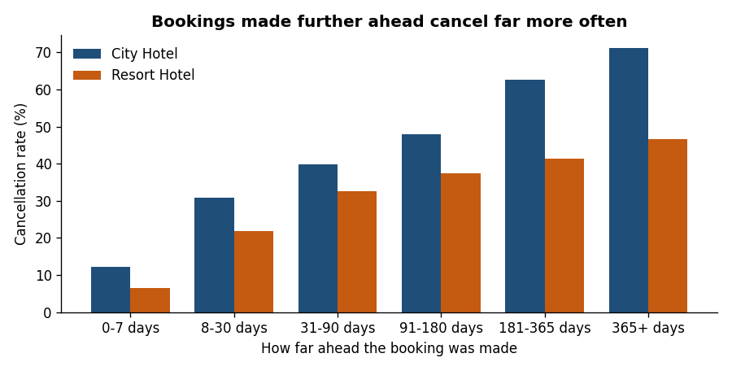
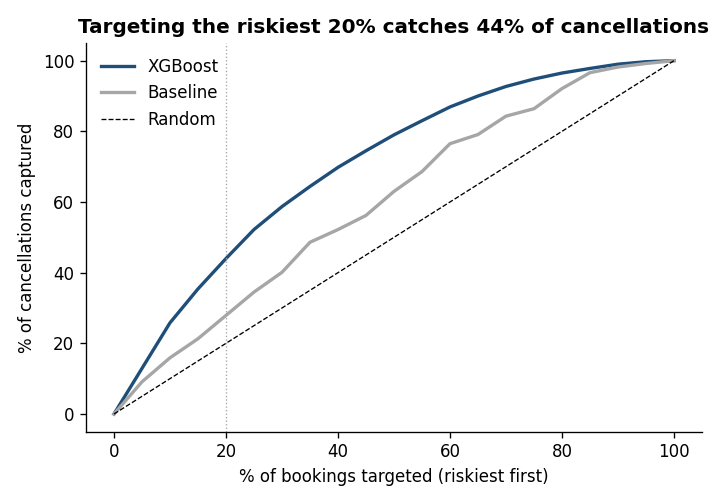
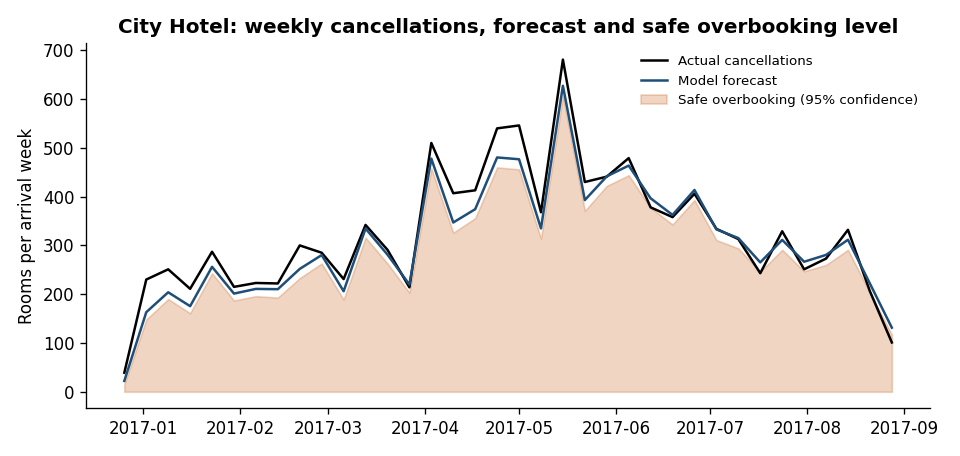

# Hotel Booking Cancellation & Revenue Analysis

How much revenue do cancellations cost two real hotels? Which bookings are most likely to cancel? And what should revenue managers do about it?

This project uses **119,390 real bookings** to answer those questions:
- **SQL** analysis of cancellations and lost revenue
- a **cancellation-prediction model**, checked on later bookings and built without "leaky" features
- **revenue decisions:** who to target, how many rooms to overbook safely, and where a deposit would help

## Data
The *Hotel Booking Demand* dataset (António, Almeida & Nunes, *Data in Brief*, 2019):
- real bookings from a **resort hotel** and a **city hotel** in Portugal, for arrivals from July 2015 to August 2017
- hotel and guest identifiers removed

Prices are average daily rates (ADR) as recorded by the hotels. The pipeline downloads a public copy of the data automatically.

## Key findings

| | Finding |
|---|---|
| **Cost of cancellations** | **37% of bookings cancelled**, representing **16.7M in booked room revenue**: 43% of booked revenue at the City Hotel and 34% at the Resort |
| **Booking window** | City Hotel cancellations rise from **12%** for bookings made within a week to **71%** for bookings made a year or more ahead |
| **Data quirk** | "Non-refundable" deposits show a **99.4%** cancellation rate. This is a known oddity of this dataset, likely from how group and agency bookings were recorded, not guest behavior. Flagged rather than "explained" |
| **Prediction** | XGBoost **ROC AUC 0.83**, vs 0.82 for logistic regression and 0.66 for a booking-window rule, tested on Jan–Aug 2017 after training on earlier arrivals |
| **Targeting** | The **riskiest 20% of bookings hold 44% of all cancellations** (85% of them cancel), vs 28% for the simple rule |
| **Overbooking** | The weekly cancellation forecast has **12.7% error vs 16.1%** for historical averages. A 95%-confidence overbooking level would have overshot in only **2.8% of hotel-weeks** |
| **Deposit policy** | High-risk **no-deposit** bookings cancel **65%** of the time (vs 32% for all no-deposit bookings) and lost **2.8M**. They're mostly online travel agent bookings made about **111 days** ahead, the clearest target for a deposit or reconfirmation policy |





## How it works

```
data.py ──▶ download + clean ──▶ data/clean/bookings.parquet
   ├─▶ sql/*.sql via DuckDB ──▶ cancellation & revenue reports
   ├─▶ model.py ──▶ logistic regression vs XGBoost (time-based test)
   ├─▶ business.py ──▶ risk targeting, weekly overbooking, deposit candidates
   └─▶ export_powerbi.py + figures.py ──▶ outputs/powerbi/*.csv, outputs/figures/*.png
```

### Cleaning (`src/data.py`)
The rules:
- Convert `"NULL"` text to missing values, and fill missing children, country, agent and company.
- Map the meal plan "Undefined" to "SC". The dataset's paper says they mean the same thing.
- Drop 180 bookings with zero guests, plus one negative and one 5,400 average daily rate.

**Kept on purpose:** 32K identical rows. There's no booking ID, so identical rows can be separate rooms in the same group booking. Every rule's count is written to `outputs/data_quality_report.md`.

### SQL (`sql/`)
| Query | Covers |
|---|---|
| `01_overview_by_hotel` | Revenue realized vs lost |
| `02_cancellations_by_lead_time` | The booking window |
| `03_cancellations_by_segment` | Market segment, deposit type and repeat guests in one query (`GROUPING SETS`) |
| `04_monthly_trend` | Seasonality, with `LAG` for the same month a year earlier |

### Model (`src/model.py`)
**Only information known when the booking is made.** These columns are **excluded because they leak the outcome:**
- reservation status and its date: they *are* the outcome
- assigned room type: set at check-in
- booking changes: keep counting until arrival
- parking spaces: in practice only recorded for guests who arrive
- **country**: the dataset's paper notes it's often only confirmed at check-in, so cancelled bookings default to Portugal (57% "cancellation rate" for Portugal vs 24% for everyone else)

Many public versions of this analysis report AUC above 0.9 by including these columns. This one doesn't.

**Validation is by time:** train on arrivals from July 2015 to December 2016, and test on January to August 2017.

### Business analysis (`src/business.py`)
**Targeting (the gains curve):** what share of cancellations sits in the riskiest X% of bookings.

**Overbooking:**
- Expected cancellations per hotel and arrival week are the sum of the predicted probabilities.
- The safe level is the expected count minus 1.645 standard deviations, which is about 95% one-sided.
- It uses the **better-calibrated** model (logistic regression, lower Brier score), because overbooking depends on the probabilities being right, not just the ranking.

The "recoverable revenue" figure (up to ~4.0M) **assumes** every overbooked room could be resold, so it's an upper bound.

### Power BI
`outputs/powerbi/` has the booking-level table with each booking's predicted risk, the SQL results, weekly overbooking and a date table. Build steps are in `powerbi/BUILD_GUIDE.md`.

## Run it
```powershell
python -m venv .venv
.\.venv\Scripts\Activate.ps1
pip install -r requirements.txt
python -m pytest -q
python -m src.pipeline      # about 10 seconds; downloads the data on first run
```

## Limitations
- Only two hotels in one country, and 2015–2017 data, so the patterns may not transfer elsewhere.
- **The forecast runs low in spring 2017**, when cancellations rose above 2016 levels. In production, I'd retrain regularly and monitor for this kind of drift.
- The value of a deposit policy can only be measured with a test. This analysis identifies **who** to target, not the guaranteed result.

## Citation
Nuno António, Ana de Almeida, Luís Nunes (2019). *Hotel booking demand datasets.* Data in Brief, 22, 41–49. https://doi.org/10.1016/j.dib.2018.11.126
